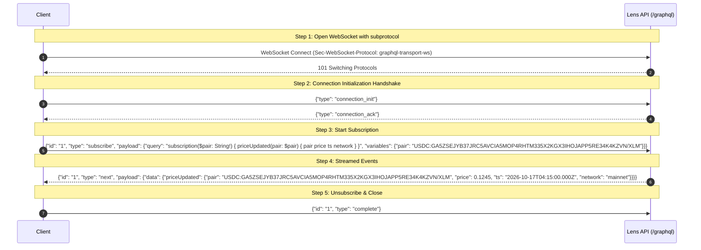

# Lens GraphQL API Documentation

Lens exposes a high-performance GraphQL API alongside its REST interface, powered by Fastify and [Mercurius](https://mercurius.dev). It aggregates real-time and historical pricing data from the Stellar Classic Decentralized Exchange (SDEX) order book and Automated Market Maker (AMM) liquidity pools.

---

## Table of Contents

1. [Endpoints & Access](#endpoints--access)
2. [Schema & Types](#schema--types)
3. [Queries & Runnable Examples](#queries--runnable-examples)
   - [`getPrice`](#1-getprice)
   - [`getBestRoute`](#2-getbestroute)
   - [`getPriceHistory`](#3-getpricehistory)
   - [`listPairs`](#4-listpairs)
4. [Live Price Subscriptions (`graphql-transport-ws`)](#live-price-subscriptions-graphql-transport-ws)
   - [Protocol Handshake Walkthrough](#protocol-handshake-walkthrough)
   - [Network Filtering Semantics](#network-filtering-semantics)
   - [Runnable Client Example (Raw WebSocket & Handshake)](#runnable-client-example-raw-websocket--handshake)
   - [Runnable Client Example (`graphql-ws` Library)](#runnable-client-example-graphql-ws-library)
5. [Capabilities & Gaps Against REST](#capabilities--gaps-against-rest)

---

## Endpoints & Access

| Interface | Protocol | URL / Path | Description |
|---|---|---|---|
| **GraphQL Query Endpoint** | HTTP POST / GET | `http://localhost:3002/graphql` | Executes GraphQL queries and introspections. |
| **GraphiQL Browser IDE** | HTTP GET | `http://localhost:3002/graphiql` | Interactive in-browser GraphQL explorer with auto-completion. |
| **GraphQL Subscription Endpoint** | WebSocket (`ws://` / `wss://`) | `ws://localhost:3002/graphql` | Real-time streaming price updates over WebSocket using `graphql-transport-ws`. |

> [!IMPORTANT]
> **WebSocket Subprotocol Requirement**: The subscription server requires the modern **`graphql-transport-ws`** subprotocol (the standard implemented by [`graphql-ws`](https://github.com/enisdenjo/graphql-ws)). Legacy Apollo `subscriptions-transport-ws` is **not** supported and will be rejected during connection initialization.

---

## Schema & Types

The complete, canonical Schema Definition Language (SDL) artifact is committed at [`schema.graphql`](../schema.graphql).
It can be regenerated from code definitions using `npm run graphql:schema:gen`, and is continuously validated against drift in CI.

### Root Operation Types

```graphql
type Query {
  getPrice(assetA: String!, assetB: String!): AggregatedPrice
  getBestRoute(assetA: String!, assetB: String!, amount: Float!): RouteInfo
  getPriceHistory(assetA: String!, assetB: String!, window: String!, limit: Int): [PriceBucket]
  listPairs: [String]!
}

type Subscription {
  priceUpdated(pair: String!, network: String): PriceUpdate!
}
```

### Object Types

#### `AggregatedPrice`
Composite pricing metrics aggregated across SDEX and AMM venues.

| Field | Type | Description |
|---|---|---|
| `assetA` | `String!` | First asset symbol or asset ID (`XLM` or `CODE:ISSUER`). |
| `assetB` | `String!` | Second asset symbol or asset ID. |
| `pairKey` | `String!` | Canonical alphabetically-sorted pair key (e.g. `USDC:GA5ZSEJYB37JRC5AVCIA5MOP4RHTM335X2KGX3IHOJAPP5RE34K4KZVN/XLM`). |
| `price` | `Float!` | Volume-weighted aggregated price across all active venues. |
| `sdexPrice` | `Float!` | Mid-market price derived strictly from the SDEX order book. |
| `ammPrice` | `Float!` | Spot price derived from AMM liquidity pool reserve ratios. |
| `bestRoute` | `String!` | Recommended trade execution path: `"SDEX"`, `"AMM"`, or `"SPLIT"`. |
| `volume24h` | `Float!` | Total 24-hour traded volume across all venues. |
| `sdexVolume24h` | `Float!` | 24-hour traded volume strictly on SDEX. |
| `ammVolume24h` | `Float!` | 24-hour traded volume strictly on AMM pools. |
| `vwap1m` | `Float!` | 1-minute volume-weighted average price. |
| `vwap5m` | `Float!` | 5-minute volume-weighted average price. |
| `vwap1h` | `Float!` | 1-hour volume-weighted average price. |
| `vwap24h` | `Float!` | 24-hour volume-weighted average price. |
| `priceChange24h` | `Float!` | 24-hour price change percentage. |
| `lastUpdated` | `String!` | ISO-8601 timestamp of last aggregate calculation. |
| `sources` | `Int!` | Count of active venues contributing to the calculation. |
| `confidence` | `String!` | Qualitative confidence indicator (e.g. `"HIGH"`, `"MEDIUM"`, `"LOW"`). |
| `lastTradeAgeSeconds` | `Int` | Seconds elapsed since the most recent ingested trade. |

#### `RouteInfo`
Routing analysis determining optimal swap execution.

| Field | Type | Description |
|---|---|---|
| `route` | `String!` | Execution venue recommendation: `"SDEX"`, `"AMM"`, or `"SPLIT"`. |
| `sdexPrice` | `Float!` | Spot price for the order on the SDEX order book. |
| `ammPrice` | `Float!` | Spot price for the order on AMM liquidity pools. |
| `estimatedOutput` | `Float!` | Projected output tokens received for the input amount. |
| `slippagePct` | `Float!` | Projected price slippage percentage. |
| `recommendation` | `String!` | Human-readable explanation of why this route was selected. |

#### `PriceBucket`
Historical OHLCV and volume aggregation bucket.

| Field | Type | Description |
|---|---|---|
| `bucket` | `String!` | ISO-8601 timestamp representing the bucket start. |
| `window` | `String!` | Bucket resolution: `"1m"`, `"5m"`, `"1h"`, or `"24h"`. |
| `vwap` | `Float!` | Combined volume-weighted average price for the window. |
| `sdexVwap` | `Float` | SDEX-specific VWAP during this bucket. |
| `ammVwap` | `Float` | AMM-specific VWAP during this bucket. |
| `volume` | `Float!` | Total volume traded during this bucket. |
| `tradeCount` | `Int!` | Number of individual trades recorded during this window. |
| `open` | `Float` | Opening price for the bucket. |
| `close` | `Float` | Closing price for the bucket. |
| `high` | `Float` | Highest price recorded during the bucket. |
| `low` | `Float` | Lowest price recorded during the bucket. |

#### `PriceUpdate`
Payload delivered on every real-time subscription event.

| Field | Type | Description |
|---|---|---|
| `pair` | `String!` | Canonical pair key (e.g. `USDC:GA5ZSEJYB37JRC5AVCIA5MOP4RHTM335X2KGX3IHOJAPP5RE34K4KZVN/XLM` or `XLM/USDC`). |
| `price` | `Float!` | Latest recorded trade or reserve spot price. |
| `ts` | `String!` | ISO-8601 timestamp of trade execution or ingestion. |
| `network` | `String!` | Network of origin: `"testnet"` or `"mainnet"`. |

---

## Queries & Runnable Examples

All examples below can be executed directly against a running Lens instance. Canonical asset representations use standard Stellar format: native lumens as `XLM` or `native`, and issued assets as `CODE:ISSUER` (for example, Circle USDC on Stellar mainnet: `USDC:GA5ZSEJYB37JRC5AVCIA5MOP4RHTM335X2KGX3IHOJAPP5RE34K4KZVN`).

### 1. `getPrice`

Retrieves the latest aggregated price, multi-timeframe VWAPs, 24-hour volume, and the current optimal trade route.

#### Query Definition
```graphql
query GetAssetPrice($assetA: String!, $assetB: String!) {
  getPrice(assetA: $assetA, assetB: $assetB) {
    assetA
    assetB
    pairKey
    price
    sdexPrice
    ammPrice
    bestRoute
    volume24h
    vwap1h
    vwap24h
    priceChange24h
    lastUpdated
    confidence
  }
}
```

#### Runnable `curl` Command
```bash
curl -s -X POST http://localhost:3002/graphql \
  -H "Content-Type: application/json" \
  -d '{
    "query": "query GetAssetPrice($assetA: String!, $assetB: String!) { getPrice(assetA: $assetA, assetB: $assetB) { assetA assetB pairKey price sdexPrice ammPrice bestRoute volume24h vwap1h vwap24h priceChange24h lastUpdated confidence } }",
    "variables": {
      "assetA": "XLM",
      "assetB": "USDC:GA5ZSEJYB37JRC5AVCIA5MOP4RHTM335X2KGX3IHOJAPP5RE34K4KZVN"
    }
  }'
```

#### Example Response
```json
{
  "data": {
    "getPrice": {
      "assetA": "XLM",
      "assetB": "USDC:GA5ZSEJYB37JRC5AVCIA5MOP4RHTM335X2KGX3IHOJAPP5RE34K4KZVN",
      "pairKey": "USDC:GA5ZSEJYB37JRC5AVCIA5MOP4RHTM335X2KGX3IHOJAPP5RE34K4KZVN/XLM",
      "price": 0.1245,
      "sdexPrice": 0.1244,
      "ammPrice": 0.1246,
      "bestRoute": "SDEX",
      "volume24h": 1425000.5,
      "vwap1h": 0.1242,
      "vwap24h": 0.1238,
      "priceChange24h": 1.25,
      "lastUpdated": "2026-10-17T04:15:00.000Z",
      "confidence": "HIGH"
    }
  }
}
```

---

### 2. `getBestRoute`

Simulates swap execution for an explicit order amount across both SDEX order books and AMM liquidity pools, calculating projected output tokens and slippage.

#### Query Definition
```graphql
query GetBestExecutionRoute($assetA: String!, $assetB: String!, $amount: Float!) {
  getBestRoute(assetA: $assetA, assetB: $assetB, amount: $amount) {
    route
    sdexPrice
    ammPrice
    estimatedOutput
    slippagePct
    recommendation
  }
}
```

#### Runnable `curl` Command
```bash
curl -s -X POST http://localhost:3002/graphql \
  -H "Content-Type: application/json" \
  -d '{
    "query": "query GetBestExecutionRoute($assetA: String!, $assetB: String!, $amount: Float!) { getBestRoute(assetA: $assetA, assetB: $assetB, amount: $amount) { route sdexPrice ammPrice estimatedOutput slippagePct recommendation } }",
    "variables": {
      "assetA": "XLM",
      "assetB": "USDC:GA5ZSEJYB37JRC5AVCIA5MOP4RHTM335X2KGX3IHOJAPP5RE34K4KZVN",
      "amount": 10000.0
    }
  }'
```

#### Example Response
```json
{
  "data": {
    "getBestRoute": {
      "route": "AMM",
      "sdexPrice": 0.1241,
      "ammPrice": 0.1246,
      "estimatedOutput": 1243.85,
      "slippagePct": 0.15,
      "recommendation": "AMM provides 0.4% higher net output after order book spread."
    }
  }
}
```

---

### 3. `getPriceHistory`

Retrieves historical aggregated price buckets (OHLCV and VWAP) for a given pair and timeframe window (`1m`, `5m`, `1h`, `24h`).

#### Query Definition
```graphql
query GetPairHistory($assetA: String!, $assetB: String!, $window: String!, $limit: Int) {
  getPriceHistory(assetA: $assetA, assetB: $assetB, window: $window, limit: $limit) {
    bucket
    window
    vwap
    sdexVwap
    ammVwap
    volume
    tradeCount
    open
    close
    high
    low
  }
}
```

#### Runnable `curl` Command
```bash
curl -s -X POST http://localhost:3002/graphql \
  -H "Content-Type: application/json" \
  -d '{
    "query": "query GetPairHistory($assetA: String!, $assetB: String!, $window: String!, $limit: Int) { getPriceHistory(assetA: $assetA, assetB: $assetB, window: $window, limit: $limit) { bucket window vwap sdexVwap ammVwap volume tradeCount open close high low } }",
    "variables": {
      "assetA": "XLM",
      "assetB": "USDC:GA5ZSEJYB37JRC5AVCIA5MOP4RHTM335X2KGX3IHOJAPP5RE34K4KZVN",
      "window": "1h",
      "limit": 5
    }
  }'
```

#### Example Response
```json
{
  "data": {
    "getPriceHistory": [
      {
        "bucket": "2026-10-17T03:00:00.000Z",
        "window": "1h",
        "vwap": 0.1243,
        "sdexVwap": 0.1242,
        "ammVwap": 0.1244,
        "volume": 68420.0,
        "tradeCount": 142,
        "open": 0.1239,
        "close": 0.1245,
        "high": 0.1248,
        "low": 0.1237
      }
    ]
  }
}
```

---

### 4. `listPairs`

Lists all canonical pair keys actively registered and watched by the indexers on the active network.

#### Query Definition
```graphql
query ListWatchedPairs {
  listPairs
}
```

#### Runnable `curl` Command
```bash
curl -s -X POST http://localhost:3002/graphql \
  -H "Content-Type: application/json" \
  -d '{
    "query": "query ListWatchedPairs { listPairs }"
  }'
```

#### Example Response
```json
{
  "data": {
    "listPairs": [
      "USDC:GA5ZSEJYB37JRC5AVCIA5MOP4RHTM335X2KGX3IHOJAPP5RE34K4KZVN/XLM"
    ]
  }
}
```

---

## Live Price Subscriptions (`graphql-transport-ws`)

Lens exposes a real-time price streaming subscription:
```graphql
subscription OnPriceUpdated($pair: String!, $network: String) {
  priceUpdated(pair: $pair, network: $network) {
    pair
    price
    ts
    network
  }
}
```

Every time an ingester (SDEX Horizon stream, Horizon AMM polling, or Soroswap reserve poller) publishes a new price update, the event is emitted to connected subscribers filtering for that pair.

---

### Protocol Handshake Walkthrough

Mercurius operates with `fullWsTransport: true` and `wsDefaultSubprotocol: 'graphql-transport-ws'`. The connection handshake proceeds through the following exact sequence:



#### Frame Specifications
1. **Connection Init**: Client sends `{"type":"connection_init"}` immediately upon opening the socket.
2. **Connection Ack**: Server acknowledges with `{"type":"connection_ack"}`.
3. **Subscribe**: Client sends `{"id":"1","type":"subscribe","payload":{"query":"subscription($pair: String!) { priceUpdated(pair: $pair) { pair price ts network } }","variables":{"pair":"USDC:GA5ZSEJYB37JRC5AVCIA5MOP4RHTM335X2KGX3IHOJAPP5RE34K4KZVN/XLM"}}}`.
4. **Next**: Server pushes data updates using `{"id":"1","type":"next","payload":{"data":{"priceUpdated":{"pair":"USDC:GA5ZSEJYB37JRC5AVCIA5MOP4RHTM335X2KGX3IHOJAPP5RE34K4KZVN/XLM","price":0.1245,"ts":"2026-10-17T04:15:00.000Z","network":"mainnet"}}}}`.
5. **Complete**: Client requests cancellation of that subscription via `{"id":"1","type":"complete"}`.

---

### Network Filtering Semantics

- **Dual-Network Deployments**: In dual-network setups, both testnet and mainnet ingesters run concurrently and emit events onto the same pubsub channel.
- **`network: "mainnet"` or `"testnet"`**: Specifying the network narrows the stream to updates originating strictly from that chain.
- **Omitting `network` (or `null`)**: Delivers updates from **all** enabled networks. In this mode, clients **must** inspect the `network` property on each incoming payload to avoid treating testnet prices as mainnet prices.

---

### Runnable Client Example (Raw WebSocket & Handshake)

This runnable Node.js script demonstrates the raw handshake protocol directly without third-party GraphQL client abstractions, using only the standard `ws` library:

```typescript
import WebSocket from 'ws';

const WS_URL = 'ws://localhost:3002/graphql';
const SUBPROTOCOL = 'graphql-transport-ws';

const targetPair = 'USDC:GA5ZSEJYB37JRC5AVCIA5MOP4RHTM335X2KGX3IHOJAPP5RE34K4KZVN/XLM';
const targetNetwork = 'mainnet';

const ws = new WebSocket(WS_URL, SUBPROTOCOL);

ws.on('open', () => {
  console.log('[ws] Connected. Sending connection_init handshake...');
  // 1. Send connection_init
  ws.send(JSON.stringify({ type: 'connection_init' }));
});

ws.on('message', (raw: Buffer) => {
  const message = JSON.parse(raw.toString());

  // 2. Handle connection_ack
  if (message.type === 'connection_ack') {
    console.log('[ws] Handshake acknowledged (connection_ack). Registering subscription...');
    
    // 3. Send subscription request
    const subscribeFrame = {
      id: 'sub-1',
      type: 'subscribe',
      payload: {
        query: `
          subscription WatchPrice($pair: String!, $network: String) {
            priceUpdated(pair: $pair, network: $network) {
              pair
              price
              ts
              network
            }
          }
        `,
        variables: {
          pair: targetPair,
          network: targetNetwork,
        },
      },
    };
    ws.send(JSON.stringify(subscribeFrame));
    return;
  }

  // 4. Handle incoming streamed price data
  if (message.type === 'next' && message.id === 'sub-1') {
    const update = message.payload.data.priceUpdated;
    console.log(`[price] ${update.network.toUpperCase()} ${update.pair} -> $${update.price} (${update.ts})`);
    return;
  }

  // Handle errors or completion
  if (message.type === 'error') {
    console.error('[ws] Subscription error:', message.payload);
  }
});

ws.on('error', (err) => console.error('[ws] Socket error:', err));
ws.on('close', (code, reason) => console.log(`[ws] Disconnected: ${code} - ${reason.toString()}`));

// To unsubscribe gracefully later:
// ws.send(JSON.stringify({ id: 'sub-1', type: 'complete' }));
// ws.close();
```

---

### Runnable Client Example (`graphql-ws` Library)

If you prefer using the official [`graphql-ws`](https://github.com/enisdenjo/graphql-ws) client library:

```bash
npm install graphql-ws ws
```

```typescript
import { createClient } from 'graphql-ws';
import WebSocket from 'ws'; // Node.js environment (browsers use native window.WebSocket)

const client = createClient({
  url: 'ws://localhost:3002/graphql',
  webSocketImpl: WebSocket,
});

const unsubscribe = client.subscribe(
  {
    query: `
      subscription WatchPrice($pair: String!, $network: String) {
        priceUpdated(pair: $pair, network: $network) {
          pair
          price
          ts
          network
        }
      }
    `,
    variables: {
      pair: 'USDC:GA5ZSEJYB37JRC5AVCIA5MOP4RHTM335X2KGX3IHOJAPP5RE34K4KZVN/XLM',
      network: 'mainnet',
    },
  },
  {
    next: (data) => console.log('Live price update:', data.data?.priceUpdated),
    error: (err) => console.error('Subscription error:', err),
    complete: () => console.log('Subscription completed'),
  }
);

// To stop listening:
// unsubscribe();
```

---

## Capabilities & Gaps Against REST

Lens was initially built around an OpenAPI-specified REST API. While GraphQL provides flexible projection and real-time WebSocket subscriptions, certain REST endpoints and operational capabilities do **not** have a GraphQL equivalent today.

The following matrix documents the differences explicitly:

| Capability / Resource | REST Route | GraphQL Operation | Status & Gaps |
|---|---|---|---|
| **Aggregated Spot Price** | `GET /price/:assetA/:assetB` | `Query.getPrice` | **Full Parity**: Returns price, multi-window VWAP, volume, and routing. |
| **Best Route Simulation** | `GET /price/:assetA/:assetB/route` | `Query.getBestRoute` | **Full Parity**: Simulates swap execution for an input amount. |
| **Price Bucket History** | `GET /price/:assetA/:assetB/history` | `Query.getPriceHistory` | **Full Parity**: Returns OHLCV and VWAP buckets (`1m`, `5m`, `1h`, `24h`). |
| **Watched Pairs List** | `GET /pairs` | `Query.listPairs` | **Full Parity**: Returns array of canonical watched pair keys. |
| **Real-Time Price Stream** | `GET /ws` (Raw JSON WebSocket) | `Subscription.priceUpdated` | **GraphQL Preferred**: Structured typed pubsub with network and pair filtering over standard `graphql-transport-ws`. |
| **Per-Request Network Scoping** | `?network=testnet\|mainnet` & `x-network` header | *No query-level parameter* | **REST Only**: GraphQL queries resolve strictly against the instance's active network (`activeNetwork`). Only `priceUpdated` subscription accepts a `network` filter argument. |
| **Order Book Depth & Slippage** | `GET /price/:assetA/:assetB/depth` | *No equivalent* | **REST Only**: Simulated order book depth curves and slippage ladders across amounts have no GraphQL equivalent. |
| **Manipulation-Resistant TWAP** | `GET /price/twap/:assetA/:assetB` | *No equivalent* | **REST Only**: Interquartile range (IQR) trimmed time-weighted average price calculation is only available on REST. |
| **Source-Specific VWAP** | `GET /price/vwap/:assetA/:assetB` | *No equivalent* | **REST Only**: Filtered VWAP calculation targeting a specific venue (`source=SDEX` or `source=AMM`) is REST-only. |
| **OHLCV Candle Time-Series** | `GET /candles/:assetA/:assetB` | *No equivalent* | **REST Only**: Configurable candlestick intervals (`1m`, `5m`, `15m`, `1h`, `4h`, `1d`) with arbitrary `from` and `to` timestamps are REST-only. |
| **High-Density History & CSV** | `GET /prices/history` | *No equivalent* | **REST Only**: Historical 1-minute price snapshot queries and CSV downloads (`?format=csv`) are REST-only. |
| **AMM Liquidity Pool Catalog** | `GET /pools` | *No equivalent* | **REST Only**: Enumerating pool IDs, reserve balances, and fee tiers is REST-only. |
| **Traded Volume Breakdown** | `GET /volumes/:asset` | *No equivalent* | **REST Only**: Multi-window volume breakdowns (`24h`, `7d`, `30d`) with per-venue attribution are REST-only. |
| **Bid/Ask Spread Metrics** | `GET /spreads/:asset` | *No equivalent* | **REST Only**: Per-venue bid/ask spread analysis is REST-only. |
| **Oracle Price Comparison** | `GET /compare/:asset` | *No equivalent* | **REST Only**: Cross-checking Lens prices against external oracles (e.g. Reflector) is REST-only. |
| **Market Screener** | `GET /screener` | *No equivalent* | **REST Only**: Multi-pair ranking by volume, liquidity, price change, and spread is REST-only. |
| **Peg / Benchmark Deviation** | `GET /benchmark/:asset` | *No equivalent* | **REST Only**: Stablecoin peg-deviation metrics against reference targets are REST-only. |
| **Synthetic Asset Basket** | `GET /basket` | *No equivalent* | **REST Only**: Computing weighted portfolio valuation across multiple assets is REST-only. |
| **Indexer Synchronization & Health** | `GET /status` | *No equivalent* | **REST Only**: Checking ledger heights, node lag seconds, and indexer operational status is REST-only. |
| **x402 Micropayment Facilitator** | `/verify`, `/settle`, `/supported`, `/discovery/resources`, `/usage/me` | *No equivalent* | **REST Only**: All x402 payment validation, settlement, and bazaar resource discovery routes are REST-only. |
| **Webhook Management** | `POST /webhooks`, `DELETE /webhooks/:id` | *No equivalent* | **REST Only**: Subscribing to price-threshold alert webhooks is REST-only. |
